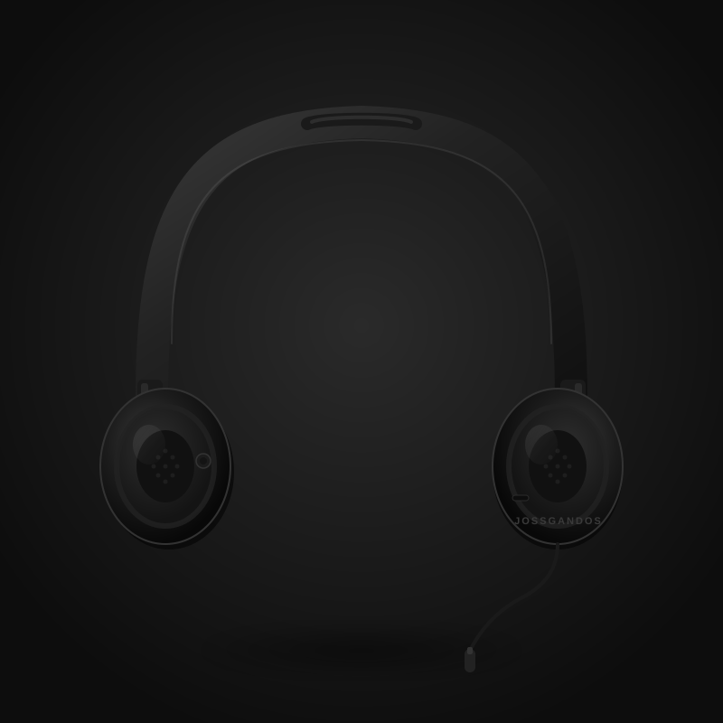

# Dokumentasi Teknis — Headset Jossgandos Product Detail Page

> Halaman detail produk frontend-only berbasis HTML, CSS, dan JavaScript murni.  
> Dibuat berdasarkan PRD Everyday Cotton T-Shirt (diubah menjadi produk Headset Jossgandos).

---

## Daftar Isi

1. [Struktur File](#1-struktur-file)
2. [index.html](#2-indexhtml)
3. [style.css](#3-stylecss)
4. [script.js](#4-scriptjs)
5. [Aset Gambar](#5-aset-gambar)
6. [State Management](#6-state-management)
7. [Alur Interaksi](#7-alur-interaksi)
8. [Aksesibilitas](#8-aksesibilitas)
9. [Responsivitas](#9-responsivitas)

---

## 1. Struktur File

```
day3/
├── index.html          ← Markup utama halaman
├── style.css           ← Semua styling & layout
├── script.js           ← Logika interaktif & state
└── assets/
    ├── headset-hitam.svg   ← Gambar produk warna Hitam
    ├── headset-putih.svg   ← Gambar produk warna Putih
    └── headset-merah.svg   ← Gambar produk warna Merah
```

---

## 2. `index.html`

### Ringkasan Struktur

```
<html lang="id">
  <head>     ← Meta, viewport, OG tags, link CSS
  <body>
    <header> ← Navbar sticky: logo + navigasi
    <main>
      <nav>              ← Breadcrumb
      <section>          ← Product section (2 kolom)
        <div.gallery>    ← Gambar utama + thumbnail strip
        <div.info>       ← Identitas produk, selectors, summary, CTA
      <section>          ← Detail tabs (Spesifikasi, Garansi, Pengiriman)
    <footer>   ← Nama toko + copyright
  <script>   ← script.js (ditempatkan sebelum </body>)
```

### Seksi-seksi Utama

#### `<header>` — Navbar Sticky

```html
<header class="site-header" role="banner">
  <div class="header-inner container">
    <a href="#" class="site-logo" aria-label="...">
      <span class="logo-icon">🎧</span>
      <span class="logo-text">Jossgandos</span>
    </a>
    <nav class="header-nav" aria-label="Navigasi utama">
      <a href="#">Beranda</a>
      <a href="#">Produk</a>
      ...
    </nav>
  </div>
</header>
```

- Menggunakan `role="banner"` untuk aksesibilitas.
- Sticky dengan `position: sticky; top: 0`.
- Nav links disembunyikan di mobile (`display: none` pada `≤768px`).

---

#### `<nav>` — Breadcrumb

```html
<nav class="breadcrumb container" aria-label="Breadcrumb">
  <ol>
    <li><a href="#">Beranda</a></li>
    <li aria-hidden="true" class="breadcrumb-sep">›</li>
    <li><a href="#">Headset</a></li>
    <li aria-hidden="true" class="breadcrumb-sep">›</li>
    <li aria-current="page">Headset Jossgandos</li>
  </ol>
</nav>
```

- Separator `aria-hidden="true"` agar tidak dibaca screen reader.
- Halaman aktif diberi `aria-current="page"`.

---

#### `.product-gallery` — Galeri Produk (Kolom Kiri)

```html
<figure class="product-main-image">
  
</figure>

<div class="product-thumbnails" role="list">
  <button class="thumb-btn" data-color="hitam" aria-pressed="false" ...>
    
  </button>
  <!-- putih, merah -->
</div>
```

- `id="product-image"` — target utama untuk swap gambar via JS.
- Thumbnail menggunakan `data-color` sebagai key referensi ke product data.
- `aria-pressed` diperbarui JS sesuai warna aktif.

---

#### `.product-info` — Informasi & Kontrol (Kolom Kanan)

**Identitas Produk:**
```html
<p class="product-category">Headset Ori</p>
<h1 class="product-name">Headset Jossgandos</h1>
<p class="product-price">Rp249.000<span class="price-per-item"> / item</span></p>
<p class="product-description">...</p>
```

**Color Selector:**
```html
<div class="color-options" role="group" aria-labelledby="color-label">
  <button class="color-btn" type="button"
          data-color="hitam" data-label="Hitam"
          aria-pressed="false" aria-label="Warna Hitam">
    <span class="color-swatch hitam"></span>
    <span class="color-name">Hitam</span>
  </button>
  <!-- putih, merah -->
</div>
```

- `role="group"` + `aria-labelledby` → screen reader tahu ini satu kelompok pilihan.
- `data-color` dipakai JS sebagai key state.
- `aria-pressed` diupdate JS: `"true"` jika aktif, `"false"` jika tidak.

**Size Selector:**
```html
<div class="size-options" role="group" aria-labelledby="size-label">
  <button class="size-btn" data-size="M"  aria-pressed="false">M</button>
  <button class="size-btn" data-size="L"  aria-pressed="false">L</button>
  <button class="size-btn" data-size="XL" aria-pressed="false">XL</button>
</div>
```

**Quantity Control:**
```html
<div class="quantity-control" role="group" aria-labelledby="qty-label">
  <button id="qty-decrease" type="button" aria-label="Kurangi jumlah" disabled>−</button>
  <output id="qty-value" aria-live="polite" aria-atomic="true">1</output>
  <button id="qty-increase" type="button" aria-label="Tambah jumlah">+</button>
</div>
```

- `<output>` elemen semantik untuk nilai yang dihitung.
- `aria-live="polite"` agar screen reader mengumumkan perubahan qty.
- `qty-decrease` dimulai dalam keadaan `disabled` (qty=1 sudah di minimum).

**Order Summary:**
```html
<div class="order-summary" aria-live="polite" aria-atomic="true">
  <dl class="summary-list">
    <div class="summary-row"><dt>Warna</dt><dd id="summary-color">—</dd></div>
    <div class="summary-row"><dt>Ukuran</dt><dd id="summary-size">—</dd></div>
    <div class="summary-row"><dt>Jumlah</dt><dd id="summary-qty">1</dd></div>
    <div class="summary-row summary-total"><dt>Total</dt><dd id="summary-total">Rp249.000</dd></div>
  </dl>
</div>
```

- `<dl>` (description list) semantik untuk pasangan label–nilai.
- `aria-live="polite"` + `aria-atomic="true"` → screen reader membaca ulang seluruh summary saat berubah.

**CTA Button:**
```html
<button class="btn-confirm" id="btn-confirm"
        type="button" disabled aria-disabled="true"
        aria-describedby="confirm-hint">
  Konfirmasi Pilihan
</button>
<p class="confirm-hint" id="confirm-hint">
  Pilih warna dan ukuran terlebih dahulu...
</p>
```

- Dimulai `disabled` + `aria-disabled="true"`.
- `aria-describedby` menghubungkan tombol ke teks petunjuk.

**Confirmation Message:**
```html
<div class="confirmation-message" id="confirmation-message"
     role="status" aria-live="assertive" aria-atomic="true" hidden>
  <span class="confirm-icon">✓</span>
  <p id="confirmation-text"></p>
</div>
```

- `role="status"` + `aria-live="assertive"` → diumumkan langsung ke screen reader.
- `hidden` attribute dikelola JS (bukan `display:none` via class).

---

#### `.product-details` — Tab Spesifikasi

```html
<div class="detail-tabs" role="tablist" aria-label="Tab informasi produk">
  <button class="tab-btn active" role="tab" aria-selected="true"
          aria-controls="tab-spesifikasi" id="tab-btn-spek">Spesifikasi</button>
  <button class="tab-btn" role="tab" aria-selected="false"
          aria-controls="tab-garansi" id="tab-btn-garansi" tabindex="-1">Garansi</button>
  ...
</div>

<div id="tab-spesifikasi" role="tabpanel" aria-labelledby="tab-btn-spek" class="tab-panel active">
  <ul class="spec-list">
    <li><strong>Driver Unit:</strong> 40mm Neodymium</li>
    ...
  </ul>
</div>
```

- Pola ARIA tabs lengkap: `role="tablist"`, `role="tab"`, `role="tabpanel"`.
- Tab non-aktif mendapat `tabindex="-1"` agar skip saat Tab keyboard.
- Navigasi antar tab via tombol ← → (keyboard).

---

#### `<footer>`

```html
<footer class="site-footer" role="contentinfo">
  <div class="footer-inner container">
    <p class="footer-brand">🎧 Jossgandos Store</p>
    <p class="footer-copy">© <span id="footer-year"></span> Jossgandos...</p>
  </div>
</footer>
```

- `role="contentinfo"` untuk aksesibilitas landmark.
- `id="footer-year"` diisi JS dengan `new Date().getFullYear()`.

---

## 3. `style.css`

### Variabel CSS (`:root`)

```css
:root {
  /* Warna */
  --clr-bg:            #fafaf8;   /* Background utama */
  --clr-bg-alt:        #f3f3ef;   /* Background seksi alternatif */
  --clr-surface:       #ffffff;   /* Background kartu/komponen */
  --clr-border:        #e4e4de;   /* Warna border default */
  --clr-border-focus:  #1a1a1a;   /* Warna outline focus */
  --clr-text-primary:  #1a1a1a;   /* Teks utama */
  --clr-text-secondary:#555550;   /* Teks paragraf */
  --clr-text-muted:    #888882;   /* Teks placeholder/label kecil */
  --clr-accent:        #1a1a1a;   /* Warna aksen (tombol aktif) */
  --clr-accent-light:  #f0f0ec;   /* Background hover ringan */
  --clr-success:       #1a7a4a;   /* Warna pesan sukses */
  --clr-disabled-bg:   #e8e8e4;   /* Background tombol disabled */
  --clr-disabled-text: #aaa;      /* Teks tombol disabled */

  /* Swatch warna produk */
  --swatch-hitam: #1a1a1a;
  --swatch-putih: #f5f5f0;
  --swatch-merah: #c0392b;

  /* Tipografi */
  --font-sans: 'Inter', 'Segoe UI', Arial, sans-serif;

  /* Spacing (basis 4px / 8px) */
  --space-1: 0.25rem;  /* 4px  */
  --space-2: 0.5rem;   /* 8px  */
  --space-3: 0.75rem;  /* 12px */
  --space-4: 1rem;     /* 16px */
  --space-6: 1.5rem;   /* 24px */
  --space-8: 2rem;     /* 32px */
  --space-12: 3rem;    /* 48px */
  --space-16: 4rem;    /* 64px */

  /* Layout */
  --max-width:     1200px;
  --header-height: 60px;

  /* Border radius */
  --radius-sm:   4px;
  --radius-md:   8px;
  --radius-lg:   12px;
  --radius-full: 9999px;

  /* Transisi */
  --transition: 0.2s ease;
}
```

---

### Layout Utama

#### `.container`
```css
.container {
  width: 100%;
  max-width: 1200px;
  margin-inline: auto;
  padding-inline: 2rem;
}
```
Digunakan sebagai wrapper di setiap seksi untuk membatasi lebar konten.

#### `.product-layout` — Two-Column Grid
```css
.product-layout {
  display: grid;
  grid-template-columns: minmax(0, 1.05fr) minmax(0, 0.95fr);
  gap: 3rem;
  align-items: start;
}
```
- Kolom kiri (gallery) sedikit lebih lebar dari kolom kanan (info).
- `align-items: start` agar kolom kanan tidak ikut stretch ke bawah.

#### `.product-gallery` — Sticky Gallery
```css
.product-gallery {
  position: sticky;
  top: calc(var(--header-height) + var(--space-6));
}
```
Gallery tetap terlihat saat user scroll ke bawah membaca info produk.

---

### Komponen-komponen CSS

#### Navbar
| Kelas | Fungsi |
|---|---|
| `.site-header` | `position: sticky`, z-index 100, border bawah |
| `.header-inner` | Flexbox space-between, tinggi penuh header |
| `.site-logo` | Flex + gap, font-weight 700 |
| `.header-nav` | Flex gap, hidden di mobile |

#### Color Button States
| State | CSS |
|---|---|
| Default | Border `--clr-border`, bg `--clr-surface` |
| Hover | Border `--clr-text-secondary`, bg `--clr-accent-light` |
| Active/Pressed | Border `--clr-accent`, box-shadow ring, bg `--clr-accent-light` |

#### Size Button States
| State | CSS |
|---|---|
| Default | Border tipis, teks `--clr-text-secondary` |
| Hover | Border lebih gelap, bg ringan |
| Active/Pressed | `background-color: --clr-accent`, `color: #fff` (inverted) |

#### Quantity Control
```css
.quantity-control {
  display: inline-flex;
  border: 1.5px solid var(--clr-border);
  border-radius: var(--radius-md);
  overflow: hidden;
}
/* Tombol − disabled: background abu, cursor not-allowed */
.qty-btn:disabled {
  color: var(--clr-disabled-text);
  background-color: var(--clr-disabled-bg);
  cursor: not-allowed;
}
```

#### CTA Button
```css
.btn-confirm {
  width: 100%;
  background-color: var(--clr-accent); /* hitam */
  color: #fff;
}
.btn-confirm:disabled {
  background-color: var(--clr-disabled-bg);
  color: var(--clr-disabled-text);
  cursor: not-allowed;
}
```

#### Confirmation Message
```css
.confirmation-message {
  background-color: var(--clr-success-bg);  /* hijau muda */
  border: 1px solid var(--clr-success-border);
  animation: fadeSlideIn 0.3s ease forwards;
}
.confirmation-message[hidden] { display: none; }

@keyframes fadeSlideIn {
  from { opacity: 0; transform: translateY(-6px); }
  to   { opacity: 1; transform: translateY(0); }
}
```

#### Image Swap Animation
```css
.product-main-image img {
  transition: opacity 0.25s ease;
}
.product-main-image img.swapping {
  opacity: 0;  /* JS adds/removes this class */
}
```

#### Tab Panel
```css
.tab-btn[aria-selected="true"] {
  color: var(--clr-text-primary);
  border-bottom: 2px solid var(--clr-accent);  /* underline aktif */
}
.tab-panel[hidden] { display: none; }
```

---

### Breakpoints Responsif

| Breakpoint | `max-width` | Perubahan Utama |
|---|---|---|
| Tablet | `1024px` | Grid proyek 1fr 1fr, spec list 1 kolom |
| Mobile | `768px` | Layout 1 kolom, nav hidden, gallery non-sticky |
| Small mobile | `480px` | Padding dikurangi, font size diperkecil |

```css
/* Mobile: 1 column */
@media (max-width: 768px) {
  .product-layout { grid-template-columns: 1fr; }
  .product-gallery { position: static; }
  .header-nav { display: none; }
}
```

---

## 4. `script.js`

### Product Data

```js
const product = {
  name: 'Headset Jossgandos',
  price: 249000,
  colors: {
    hitam: { label: 'Hitam', image: './assets/headset-hitam.svg' },
    putih: { label: 'Putih', image: './assets/headset-putih.svg' },
    merah: { label: 'Merah', image: './assets/headset-merah.svg' },
  },
  sizes: ['M', 'L', 'XL'],
  stock: 10,
  minQty: 1,
  maxQty: 10,
};
```

Data produk disimpan langsung di frontend — tidak ada API/backend.

---

### Application State

```js
const state = {
  selectedColor: null,   // null | 'hitam' | 'putih' | 'merah'
  selectedSize:  null,   // null | 'M' | 'L' | 'XL'
  quantity:      1,      // integer 1–10
  confirmation:  null,   // null | string pesan konfirmasi
};
```

**Initial state per PRD:**
- `selectedColor: null` → warna belum dipilih
- `selectedSize: null` → ukuran belum dipilih
- `quantity: 1` → default 1 item
- `confirmation: null` → pesan tidak ditampilkan

State di-reset otomatis saat halaman di-reload (tidak ada persistensi).

---

### Fungsi-fungsi Utama

#### `render()`
```js
function render() {
  renderImage();
  renderColorSelector();
  renderSizeSelector();
  renderQuantity();
  renderSummary();
  renderCTA();
}
```
Satu entry point yang memanggil semua sub-render. Dipanggil setiap kali state berubah.

---

#### `renderImage()`
```js
let lastRenderedColor = null;

function renderImage() {
  if (!state.selectedColor) return;
  if (state.selectedColor === lastRenderedColor) return;

  const colorData = product.colors[state.selectedColor];
  lastRenderedColor = state.selectedColor;

  productImage.classList.add('swapping');       // opacity → 0
  setTimeout(() => {
    productImage.src = colorData.image;          // ganti src
    productImage.alt = `...warna ${colorData.label}`;
    productImage.classList.remove('swapping');   // opacity → 1
  }, 200);
}
```
- Menggunakan variabel `lastRenderedColor` (bukan `src.endsWith()`) untuk menghindari bug perbandingan URL absolut vs relatif.
- Animasi fade-out/fade-in 200ms via CSS `transition: opacity`.

---

#### `renderColorSelector()`
- Loop semua `.color-btn` dan `.thumb-btn`
- Toggle `.active` class berdasarkan `btn.dataset.color === state.selectedColor`
- Update `aria-pressed` attribute
- Update label teks `#color-selected-label`

#### `renderSizeSelector()`
- Loop semua `.size-btn`
- Toggle `.active` dan `aria-pressed`
- Update label teks `#size-selected-label`

#### `renderQuantity()`
```js
function renderQuantity() {
  qtyValue.textContent = state.quantity;
  qtyDecrease.disabled = state.quantity <= product.minQty;  // disabled di qty=1
  qtyIncrease.disabled = state.quantity >= product.maxQty;  // disabled di qty=10
}
```

#### `renderSummary()`
```js
function renderSummary() {
  summaryColor.textContent = state.selectedColor
    ? product.colors[state.selectedColor].label : '—';
  summarySize.textContent  = state.selectedSize ?? '—';
  summaryQty.textContent   = state.quantity;
  summaryTotal.textContent = formatRupiah(product.price * state.quantity);
}
```

#### `renderCTA()`
```js
function renderCTA() {
  const canConfirm = state.selectedColor !== null && state.selectedSize !== null;
  btnConfirm.disabled = !canConfirm;
  btnConfirm.setAttribute('aria-disabled', String(!canConfirm));
}
```
Tombol aktif **hanya** jika warna **dan** ukuran keduanya sudah dipilih.

---

#### `showConfirmation()` & `clearConfirmation()`
```js
function showConfirmation() {
  confirmationText.textContent =
    `Pilihan dikonfirmasi: ${colorLabel}, ${sizeLabel}, ${qty} item. Total ${total}.`;
  confirmationMsg.hidden = false;
  confirmationMsg.scrollIntoView({ behavior: 'smooth', block: 'nearest' });
}

function clearConfirmation() {
  if (!confirmationMsg.hidden) {
    confirmationMsg.hidden = true;
    confirmationText.textContent = '';
    state.confirmation = null;
  }
}
```
`clearConfirmation()` dipanggil oleh **semua** event handler (warna, ukuran, qty) untuk memastikan pesan lama hilang saat pilihan berubah (AC-10).

---

#### `formatRupiah(amount)`
```js
function formatRupiah(amount) {
  return 'Rp' + amount.toLocaleString('id-ID');
}
// 249000 → "Rp249.000"
// 498000 → "Rp498.000"
```
Menggunakan `toLocaleString('id-ID')` untuk format titik ribuan standar Indonesia.

---

### Event Handlers

| Event | Target | Aksi |
|---|---|---|
| `click` | `.color-btn` | Set `state.selectedColor`, clear confirmation, render |
| `click` | `.thumb-btn` | Sama seperti color btn |
| `click` | `.size-btn` | Set `state.selectedSize`, clear confirmation, render |
| `click` | `#qty-decrease` | `state.quantity -= 1` (min 1), clear confirmation, render |
| `click` | `#qty-increase` | `state.quantity += 1` (max 10), clear confirmation, render |
| `keydown` | `#qty-value` | ArrowUp/Down untuk ubah qty via keyboard |
| `click` | `#btn-confirm` | Tampilkan pesan konfirmasi |
| `click` | `.tab-btn` | Aktifkan tab panel |
| `keydown` | `.tab-btn` | Arrow ← → / Home / End navigasi tab |

---

### Tab Panel Keyboard Navigation

```js
function activateTab(index) {
  tabBtns.forEach((btn, i) => {
    btn.classList.toggle('active', i === index);
    btn.setAttribute('aria-selected', String(i === index));
    btn.tabIndex = (i === index) ? 0 : -1;  // roving tabindex
  });
  tabPanels.forEach((panel, i) => {
    panel.hidden = i !== index;
  });
}
```
Mengimplementasikan pola **roving tabindex** — hanya tab aktif yang bisa di-Tab, tab lain navigasi via arrow key.

---

## 5. Aset Gambar

| File | Warna | Background |
|---|---|---|
| `headset-hitam.svg` | Hitam | Dark gradient `#2a2a2a → #0d0d0d` |
| `headset-putih.svg` | Putih/Cream | Light gradient `#f0ede8 → #d8d4cc` |
| `headset-merah.svg` | Merah | Dark warm `#1a0505` |

Semua gambar adalah SVG inline dengan:
- Gradien radial untuk kedalaman (shading)
- Komponen: headband arc, slider arm, ear cup (outer shell + cushion + grille + dots), brand label, kabel
- Ground shadow dengan `feGaussianBlur` filter
- Highlight shine overlay

---

## 6. State Management

### Diagram State

```
Initial State
  selectedColor: null
  selectedSize:  null
  quantity:      1
  confirmation:  null
        │
        ├─ Pilih warna ──────────→ selectedColor = 'hitam'|'putih'|'merah'
        │                          clearConfirmation() + render()
        │
        ├─ Pilih ukuran ─────────→ selectedSize = 'M'|'L'|'XL'
        │                          clearConfirmation() + render()
        │
        ├─ Qty + atau − ─────────→ quantity = 1..10
        │                          clearConfirmation() + render()
        │
        └─ Konfirmasi (jika        confirmation = string pesan
           color & size dipilih)   confirmationMsg.hidden = false
```

### Aturan State

| Kondisi | Akibat |
|---|---|
| `selectedColor === null` | Gambar tidak diganti, summary warna = "—" |
| `selectedSize === null` | Summary ukuran = "—" |
| `selectedColor !== null AND selectedSize !== null` | `btn-confirm` aktif |
| `quantity === 1` | `qty-decrease` disabled |
| `quantity === 10` | `qty-increase` disabled |
| Perubahan warna/ukuran/qty setelah konfirmasi | `clearConfirmation()` → pesan lama hilang |
| Reload halaman | Semua state kembali ke initial (tidak ada localStorage) |

---

## 7. Alur Interaksi

```
1. User buka halaman
   → Initial render: qty=1, semua selector kosong, btn-confirm disabled

2. User klik warna (misal: Merah)
   → state.selectedColor = 'merah'
   → renderImage(): foto swap dengan fade animation
   → renderColorSelector(): tombol Merah aktif, label diperbarui
   → renderSummary(): summary warna = "Merah"

3. User klik ukuran (misal: L)
   → state.selectedSize = 'L'
   → renderSizeSelector(): tombol L aktif
   → renderCTA(): btn-confirm aktif (kedua selector sudah terisi)

4. User klik tombol + (qty jadi 2)
   → state.quantity = 2
   → renderQuantity(): tampil "2", btn − aktif
   → renderSummary(): total = Rp498.000

5. User klik "Konfirmasi Pilihan"
   → showConfirmation()
   → Tampil: "Pilihan dikonfirmasi: Merah, L, 2 item. Total Rp498.000."
   → confirmationMsg.hidden = false + animasi fadeSlideIn

6. User ubah warna ke Hitam
   → clearConfirmation(): pesan konfirmasi hilang
   → render() ulang semua komponen
```

---

## 8. Aksesibilitas

| Fitur | Implementasi |
|---|---|
| Landmark roles | `role="banner"`, `role="contentinfo"`, `role="status"` |
| Navigasi keyboard | `:focus-visible` outline 2px, semua kontrol bisa di-Tab |
| ARIA group | `role="group"` + `aria-labelledby` pada color/size/qty |
| Toggle state | `aria-pressed` pada color & size buttons |
| Live region | `aria-live="polite"` pada qty output & color/size label |
| Live assertive | `aria-live="assertive"` pada confirmation message |
| Tab pattern | `role="tablist"`, `role="tab"`, `role="tabpanel"`, roving tabindex |
| Gambar alt | Semua `` punya `alt` yang deskriptif, diupdate JS saat swap |
| Reduced motion | `@media (prefers-reduced-motion: reduce)` nonaktifkan animasi |
| Disabled state | `disabled` HTML attribute + `aria-disabled="true"` JS attribute |
| Breadcrumb | `aria-current="page"` pada item aktif |
| Separator | `aria-hidden="true"` pada separator `›` |

---

## 9. Responsivitas

### Breakpoint Table

| Breakpoint | Lebar | Navbar | Layout | Grid Spec |
|---|---|---|---|---|
| Desktop | ≥ 1025px | Link horizontal | 2 kolom (1.05fr / 0.95fr) | 2 kolom |
| Tablet | 769px–1024px | Link horizontal | 2 kolom (1fr / 1fr) | 1 kolom |
| Mobile | ≤ 768px | Hidden (hamburger belum ada) | 1 kolom | 1 kolom |
| Small mobile | ≤ 480px | Hidden | 1 kolom, padding kecil | 1 kolom |

### Prinsip Responsif yang Diterapkan

- `box-sizing: border-box` pada semua elemen
- `max-width: 100%` pada gambar
- `padding-inline` (bukan margin negatif) untuk menghindari overflow
- Grid collapse alami: `grid-template-columns: 1fr` di mobile
- Font size dikurangi bertahap per breakpoint
- Gallery `position: sticky` → `position: static` di mobile

---

*Dokumentasi ini mencerminkan kondisi kode pada versi terakhir yang dibuat.*
